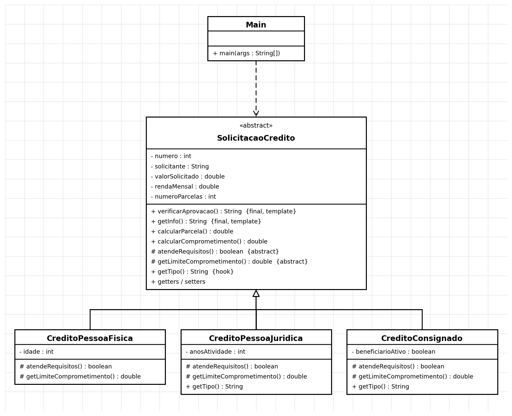

# Padrão Template Method — Análise de Solicitação de Crédito


## Diagrama UML



## Executar
```
mvn test
mvn compile exec:java -Dexec.mainClass=padroescomportamentais.templatemethod.Main
```
Requer JDK 11+ e Maven. No IntelliJ: *File > Open* e escolha a pasta (ou o `pom.xml`).
